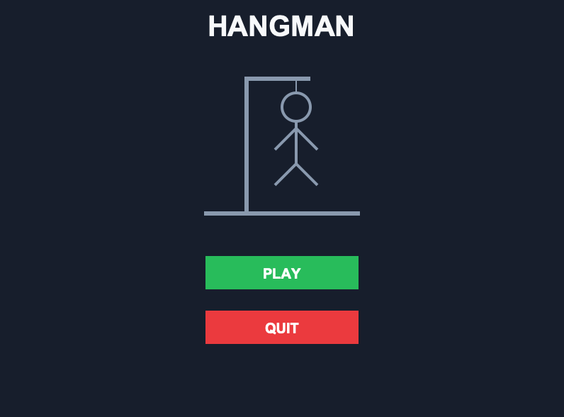
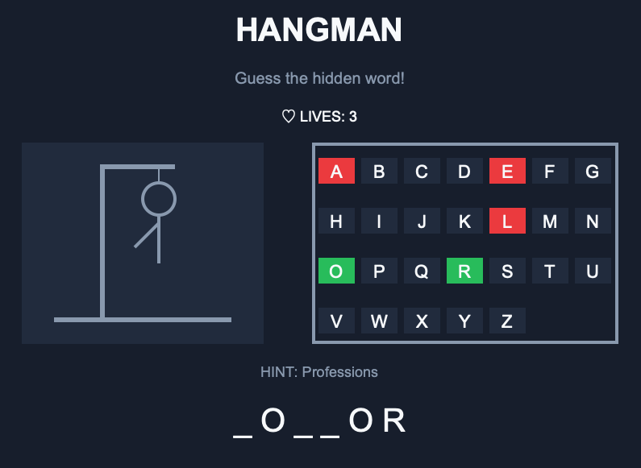
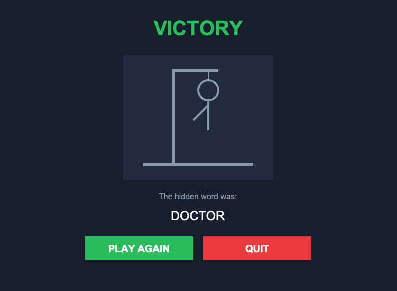
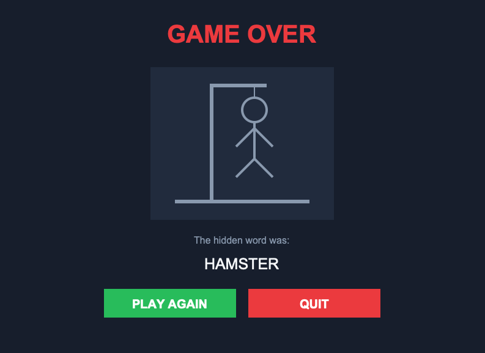

# Hangman Game

A graphical Hangman game built with Python and Tkinter. The player must guess a hidden word by selecting letters from an on-screen keyboard. Each incorrect guess reduces the number of remaining lives and reveals another part of the hangman.

## Features

- **Random Words:** A random word is selected from a word bank divided into different themes.
- **Hints:** Each word comes with a theme to help the player.
- **Interactive Keyboard:** Select letters using the on-screen keyboard.
- **Lives System:** The player starts with six lives. Each incorrect guess reveals another part of the hangman.
- **Win and Lose Screens:** Displays the game result and reveals the correct word.
- **Replay Option:** Start a new game without restarting the application.

## Technologies Used

- Python
- Tkinter
- JSON

## Project Structure

```text
Hangman/
│
├── gui.py
├── word_list.py
├── words.json
├── .gitignore
└── README.md
```

## How to Run

1. Clone this repository:

   ```bash
   git clone https://github.com/zegostinho/Hangman_game_python
   ```

2. Navigate to the project folder:

   ```bash
   cd Hangman_game
   ```

3. Run the application:

   ```bash
   python gui.py
   ```

**Note:** Python 3 and Tkinter are required to run this application.

## Build the macOS Application

This project can also be packaged as a standalone macOS application using [PyInstaller](https://pyinstaller.org/).

To build the application:

1. Install PyInstaller:

   ```bash
   python -m pip install pyinstaller
   ```

2. Run the following command from the project directory:

   ```bash
   python -m PyInstaller --windowed --name Hangman --add-data "words.json:." gui.py
   ```

3. Once the build is complete, open the `dist` folder and run `Hangman.app`.

The generated application can run independently without requiring a separate Python installation.

**Note:** This application was built for macOS. To create an executable for another operating system, PyInstaller must be run on that operating system.

## Screenshots
**Initial Menu**


**Game Screen**


**Results Screen**



## What I Learned

Through this project, I improved my Python skills and gained practical experience with Tkinter. I learned how to create graphical interfaces, manage user interactions, work with events and update interface elements dynamically.

I also practised organising code into separate files and managing data using JSON.